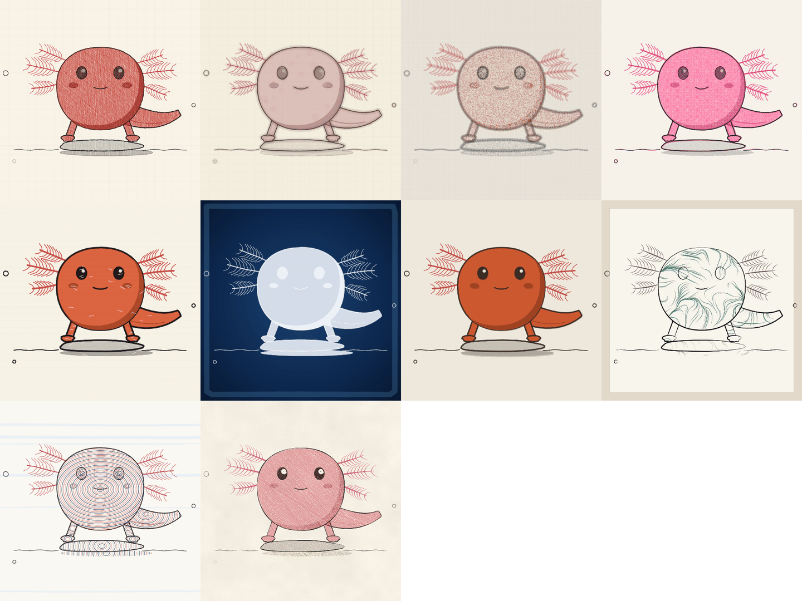

# flipbook

Flipbook turns a process, numbers, an SVG or a script into a hand-drawn animation, and checks the rendered pixels before you ship it.


The example plants a bug on purpose: paying never checks whether the trompo still has meat. `model.mjs` searches every reachable state and reports the shortest path to the broken rule (order, the pastor runs out, pay, no tacos), and the drawing traces that path in red.

| Input | Recipe | What comes back |
|---|---|---|
| A process (code, a chat flow, a policy) | `taqueria` | A chart walked by a token. Broken rules are traced in red. |
| Numbers | `embudo` | A funnel in pencil. The biggest drop is circled, and its loss is computed from the data. |
| An SVG (logo, icon, map) | `dibujar-svg` | A pen draws it stroke by stroke, then colours it in ([sheet](assets/dibujar.png)). |
| A script or lyric | `cancion` | Words written on the frame they are said. A check enforces the reading time. |
| A character or mascot | `ajolote` | Breathes, blinks, sways its gills, hops once. The same scene becomes a sticker with one flag. |

Outputs: MP4, WhatsApp-ready MP4, GIF, WebM, PNG, one-file HTML and animated WebP stickers. A scene is one HTML file that opens from `file://`, with no build step and no runtime dependencies.




The sheet runs left to right, top to bottom: crayon, watercolor, charcoal, riso, mokuhanga, cyanotype, gouache, engraving, suminagashi, pencil.

## Install

From the repo root, symlink `skills/flipbook` into your agent's skills folder. For Claude Code that is `~/.claude/skills`:

```bash
ln -s "$PWD/skills/flipbook" ~/.claude/skills/flipbook
```

You need Node 22 or later, Google Chrome (or set `CHROME` to its path), and ffmpeg.

## Loop

Run these from `skills/flipbook`:

```bash
node scripts/new.mjs taqueria ./mi-flujo            # start from the closest recipe, never from zero
node scripts/model.mjs ./mi-flujo/flow.js --write   # flows only: exit 1 = the process is wrong
node scripts/lint.mjs ./mi-flujo/scene.html         # static: randomness, glow, paper on the boil stream
node scripts/check.mjs ./mi-flujo/scene.html        # real pixels at 16:9, 1:1 and 9:16
node scripts/render.mjs ./mi-flujo/scene.html --format 1:1 --fast --sheet --onion
```

Then read the sheet and the onion. `SKILL.md` has the delivery commands, and `references/defects.md` lists every code.

## Test

```bash
npm test
```

## License

MIT. See [LICENSE](LICENSE).
